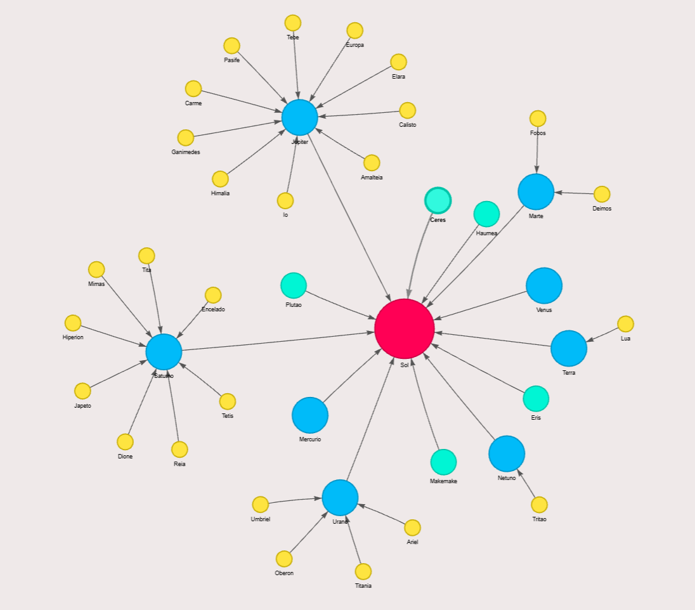

# 🪐 AstroGraph — Knowledge Graph do Sistema Solar

Base de conhecimento semântica modelada como um **Grafo Direcionado (`DiGraph`)** representando os principais corpos celestes do Sistema Solar e seus relacionamentos orbitais.

Projeto desenvolvido para a disciplina de **Algoritmos e Estrutura de Dados** da **Escola Politécnica de Pernambuco (POLI/UPE)**.

---

## 📌 Visão Geral

O **AstroGraph** aplica o conceito de **Knowledge Graphs (Grafos de Conhecimento)** para estruturar entidades astronômicas e suas conexões gravitacionais:

* **Vértices (40 Nós):** Corpos celestes categorizados por `tipo` (*Estrela*, *Planeta*, *Planeta Anão* e *Satélite Natural*) e `classificacao` (*Anã Amarela*, *Rochoso*, *Gigante Gasoso*, *Gigante Gelado*, *Plutoide*, *Galileana*, entre outros).
* **Arestas (39 Relacionamentos Direcionados):** Conexões semânticas do tipo `ORBITA` partindo do corpo orbital em direção ao seu centro gravitacional, contendo o atributo `distancia_km` (distância orbital média em quilômetros).



---

## 🛠️ Tecnologias Utilizadas

* **[Python 3](https://www.python.org/):** Linguagem base da aplicação.
* **[NetworkX](https://networkx.org/):** Criação, consulta e manipulação da estrutura de dados em grafo direcionado (`nx.DiGraph`).
* **[PyVis](https://pyvis.readthedocs.io/):** Renderização da topologia do grafo em uma página HTML interativa (`vis.js`) utilizando o algoritmo de física *ForceAtlas2*.

---

## 📂 Estrutura do Repositório

```text
astro-graph/
├── assets/
│   └── preview.png           # Captura da visualização interativa do grafo
├── src/
│   ├── __init__.py
│   ├── data.py               # Base de conhecimento (astros e conexões orbitais)
│   ├── graph_manager.py      # Criação e operações de consulta/manipulação do grafo
│   └── visualizer.py         # Motor de renderização interativa via PyVis
├── main.py                   # Ponto de entrada com menu CLI
├── sistema_solar.html        # Visualização interativa gerada pelo PyVis
├── requirements.txt          # Dependências do projeto
└── README.md                 # Documentação do projeto
```

---

## 🚀 Como Executar

### 1. Clonar o repositório
```bash
git clone https://github.com/AntoniooAlbuquerque/astro-graph.git
cd astro-graph
```

### 2. Criar e ativar o ambiente virtual (opcional, recomendado)
```bash
python -m venv .venv
# Windows (PowerShell):
.venv\Scripts\Activate.ps1
# Linux/macOS:
source .venv/bin/activate
```

### 3. Instalar as dependências
```bash
pip install -r requirements.txt
```

### 4. Executar a aplicação
```bash
python main.py
```

### 5. Visualizar o Grafo
Você pode gerar um novo arquivo atualizado pela opção **Gerar Visualização Interativa (HTML)** no menu do terminal ou abrir diretamente o arquivo `sistema_solar.html` em qualquer navegador web para explorar, arrastar e inspecionar os nós.

---

## ⚙️ Funcionalidades da Aplicação

A interface via linha de comando (CLI) permite manipular dinamicamente a base de conhecimento em memória:

1. **Consultar Astro e Órbitas:** Exibe propriedades do nó (`tipo` e `classificacao`), qual corpo celeste ele orbita (sucessor) e quais satélites o orbitam (predecessores).
2. **Adicionar Novo Astro:** Insere um novo vértice com atributos semânticos no grafo.
3. **Adicionar Nova Órbita:** Cria uma aresta direcionada `ORBITA` com distância média entre dois astros existentes.
4. **Remover Astro:** Exclui um vértice e todos os seus vínculos orbitais associados.
5. **Remover Órbita:** Remove um relacionamento orbital específico entre dois astros.
6. **Gerar Visualização Interativa:** Exporta o estado atual do grafo para `sistema_solar.html` com codificação visual por cor e escala de tamanho por categoria astronômica.

---

## 🎨 Legenda Visual (`sistema_solar.html`)

| Categoria | Cor no Grafo | Escala | Exemplo |
| :--- | :---: | :---: | :--- |
| **Estrela** | 🔴 `#ff0055` | Grande | Sol |
| **Planeta** | 🔵 `#00bbf9` | Média-Grande | Terra, Júpiter, Saturno |
| **Planeta Anão** | 🟢 `#00f5d4` | Média | Plutão, Ceres, Éris |
| **Satélite Natural** | 🟡 `#fee440` | Pequena | Lua, Titã, Europa, Tritão |

---

## 👨‍💻 Autor

Desenvolvido por **[Antônio Carlos Pessoa de Albuquerque](https://github.com/AntoniooAlbuquerque)** — Estudante de Engenharia da Computação na **POLI/UPE**.